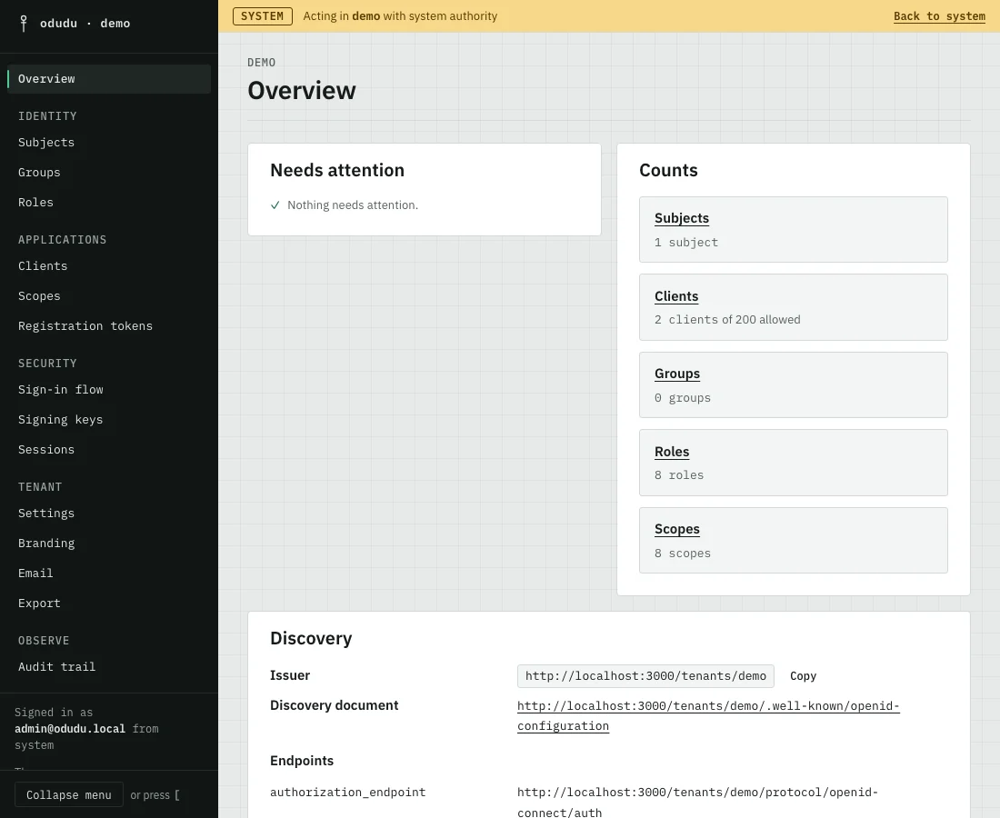
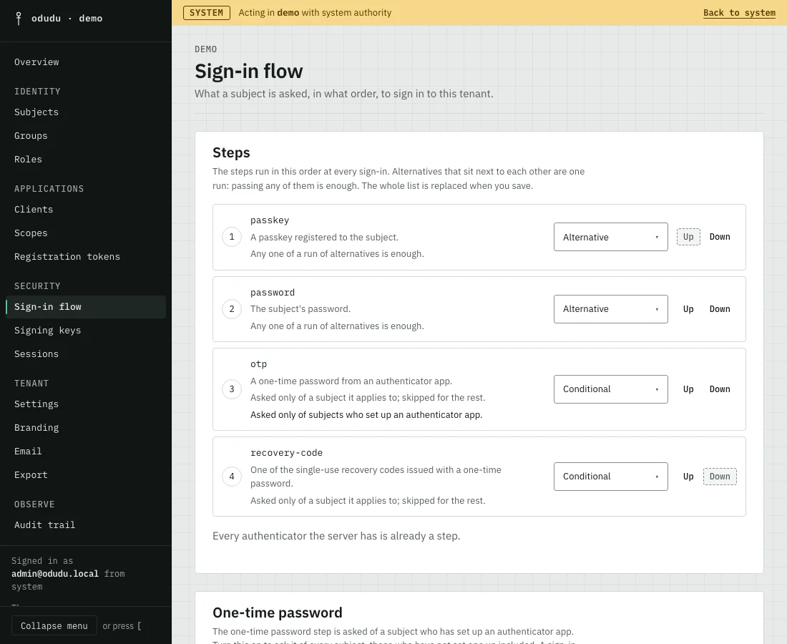
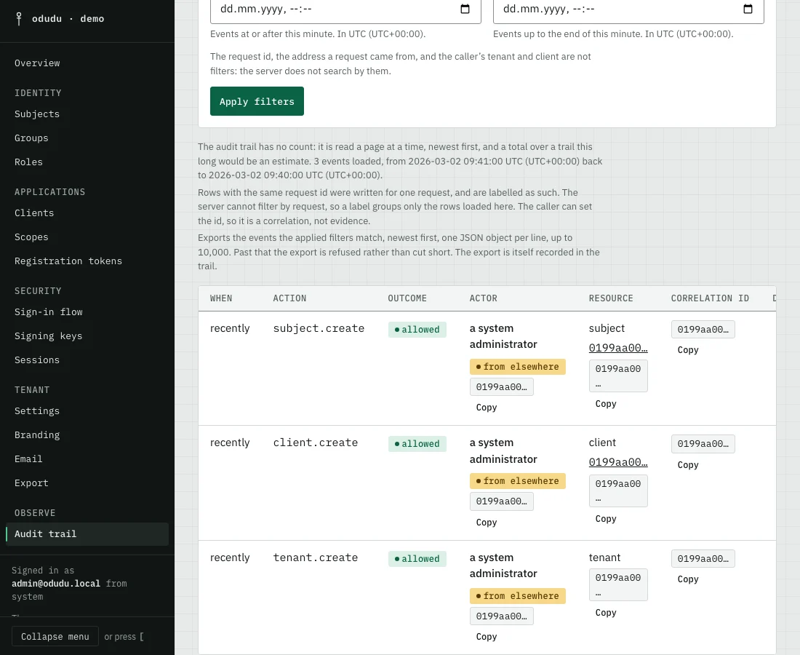

<div align="center">

<picture>
  <source media="(prefers-color-scheme: dark)" srcset="brand/lockup-paper.svg">
  
</picture>

**The sign-in you own: multi-tenant, brandable, and built for apps, MCP servers and AI agents.**
OpenID Connect and OAuth 2.0, many tenants, one container and PostgreSQL.

[](https://github.com/wizzywit/odudu/actions/workflows/verify.yml)
[](LICENSING.md)
[](https://wizzywit.github.io/odudu/docs/)
[](https://github.com/wizzywit/odudu/releases)
[](https://github.com/wizzywit/odudu/pkgs/container/odudu)

[Documentation](https://wizzywit.github.io/odudu/docs/) · [Quick start](https://wizzywit.github.io/odudu/docs/quick-start/) · [Roadmap](https://wizzywit.github.io/odudu/docs/roadmap/) · [Examples](examples/)

</div>

> **A release candidate.** Odudu has not had an independent security review yet.
> Use it with your own apps and real sign-ins, start small, and tell us what you find.

Odudu signs people in to your apps. It is for teams that want to run their own
sign-in, with single sign-on, passkeys and an admin API, and keep their users'
data on their own servers.

## Why Odudu

- Many tenants in one container, each kept apart by the database itself.
- Passkeys, recovery codes and single sign-on, built in.
- An admin API and console that cover everything, and access for agents: token exchange, client credentials and an MCP server.

<p align="center">
  
</p>

## What it does

- Authorization code flow with PKCE, always required, plus discovery, signing keys, user info, introspection and revocation.
- Refresh tokens that rotate, with a stolen one caught on reuse.
- Client credentials and token exchange, for machines, for agents and for acting on someone's behalf.
- Single sign-on across a tenant's apps, with back-channel logout.
- Many tenants on one server, kept apart by the database itself.
- Passwords with a policy and lockouts, passkeys, authenticator codes and recovery codes.
- Every page the server shows in a tenant's theme and a client's branding: colours, font, images, a stylesheet and page templates, previewed and published as versions.
- An MCP server that hands an AI agent the admin API as tools, held to the same capabilities as everyone else.
- An admin API with more than a hundred operations, and a console with a page for every area.
- An audit trail of every change, sign-in and refusal, filterable and exportable.
- One container plus PostgreSQL, started with Docker Compose.

<p align="center">
  <picture>
    <source media="(prefers-color-scheme: dark)" srcset="apps/docs/static/console/overview-dark.webp">
    
  </picture>
  <picture>
    <source media="(prefers-color-scheme: dark)" srcset="apps/docs/static/console/flow-dark.webp">
    
  </picture>
  <picture>
    <source media="(prefers-color-scheme: dark)" srcset="apps/docs/static/console/audit-dark.webp">
    
  </picture>
</p>

## Quick start

You need Docker with Compose v2 and `curl`.

```sh
curl -fsSLO https://github.com/wizzywit/odudu/releases/download/v0.1.0-rc.4/compose.yaml && docker compose up -d
docker compose logs setup
```

In Windows PowerShell, `curl` is another command, so start it like this:

```powershell
curl.exe -fsSLO https://github.com/wizzywit/odudu/releases/download/v0.1.0-rc.4/compose.yaml
docker compose up -d
```

The second command prints the console address, the administrator's email and a
one-time password. [The quick start](https://wizzywit.github.io/odudu/docs/quick-start/)
takes you from there to a signed-in app. This is a release candidate. Try it and
tell us what breaks. You can also
[run it from a checkout](https://wizzywit.github.io/odudu/docs/contributing/run-from-a-checkout/).

## Documentation

- [Guides](https://wizzywit.github.io/odudu/docs/guides/) for signing in from a web app, a single-page app, an API or a machine.
- [Examples](examples/), four small apps that run in CI.
- [Concepts](https://wizzywit.github.io/odudu/docs/concepts/), [operating Odudu](https://wizzywit.github.io/odudu/docs/operating/) and the [reference](https://wizzywit.github.io/odudu/docs/reference/).
- [How it compares with Keycloak](https://wizzywit.github.io/odudu/docs/introduction/compare/).

## Status

Odudu is before 1.0, a release candidate. Some of what is described here is
still being built. [The roadmap](https://wizzywit.github.io/odudu/docs/roadmap/)
shows what is ready. A hosted service is in the works. Nothing about it is for
sale or scheduled yet.

## Contributing and security

Read [CONTRIBUTING.md](CONTRIBUTING.md) before you send a change, and the
[code of conduct](CODE_OF_CONDUCT.md). Report a vulnerability privately, as
[SECURITY.md](SECURITY.md) describes.

## Licence

The server, console and tools are AGPL-3.0-only. The guides and the examples are
Apache-2.0. [LICENSING.md](LICENSING.md) says which directory is which.

Odudu and the staff mark are the property of Wisdom Praise. The software is licensed under the AGPL; the name and the mark are used under the trademark policy. The policy is [TRADEMARK.md](TRADEMARK.md).
